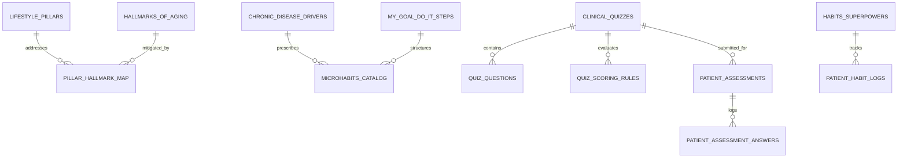

# LiveWell Clinical & Lifestyle Database Documentation

**Source Material:** *"LIVE WELL: 8 habits to highly effective Health and Happiness"*  
**Author:** Dr. Murthy Gokula, MD, CMD, Dip ABLM, Dip FAAARM  
**Co-Authors:** Laya Gokula, Vihana Shresta, Taarini Pappula, Neha Chanda  
**Copyright:** © 2025 Murthy Gokula, MD  
**Database File:** [`backend/database/livewell.db`](file:///Users/saisharankaranam/Desktop/FUZZY-1/backend/database/livewell.db)  
**Schema DDL:** [`backend/database/schema.sql`](file:///Users/saisharankaranam/Desktop/FUZZY-1/backend/database/schema.sql)  
**JSON Knowledge Base:** [`backend/database/livewell_data.json`](file:///Users/saisharankaranam/Desktop/FUZZY-1/backend/database/livewell_data.json)  

---

## 1. Overview & Entity Relationship Diagram (ERD)

The LiveWell database frames the clinical lifestyle medicine protocols, psychometric assessment tools, and cellular longevity interventions described by Dr. Murthy Gokula into a structured relational model:

---

## 2. Database Tables Summary

The database is structured into **17 tables** storing **220+ verified clinical records**:

| Table Name | Records | Clinical & Domain Focus |
| :--- | :---: | :--- |
| `book_metadata` | 1 | Book title, authors, credentials, copyright, and thesis context. |
| `lifestyle_pillars` | 6 | The 6 American College of Lifestyle Medicine (ACLM) foundational pillars. |
| `hallmarks_of_aging` | 9 | The 9 cellular aging engines (Lopez-Otín et al., *Cell* 2013). |
| `pillar_hallmark_map` | 19 | Cross-mapping table linking lifestyle interventions directly to cellular repair mechanisms. |
| `habits_superpowers` | 8 | The 8 Habits / Superheroes (Movement Master, Fuel Captain, Gut Guardian, etc.). |
| `ashtanga_limbs` | 8 | The 8 Limbs of Ashtanga Yoga (Patanjali) mapped to health transformation & happiness. |
| `chronic_disease_drivers` | 8 | Interconnected clinical drivers (Gut, Inflammation, Insulin Resistance, Toxins, etc.). |
| `my_goal_do_it_steps` | 10 | The 10-step behavioral science microhabit framework (M, Y, G, O, A, L, D, O, I, T). |
| `microhabits_catalog` | 40 | Catalog of actionable daily microhabits for chronic disease reversal. |
| `clinical_quizzes` | 7 | 7 validated screening questionnaires across metabolic, endocrine, and toxic health. |
| `quiz_questions` | 71 | 71 screening questions with clinical categories, options, and point weightings. |
| `quiz_scoring_rules` | 22 | Triage rules defining Low, Mild, Moderate, High, and Severe risk thresholds. |
| `therapeutic_supplements`| 10 | Evidence-based botanicals (Curcumin, Omega-3, Boswellia, CoQ10, Berberine). |
| `lab_biomarkers` | 15 | Standard insurance-covered panels vs. advanced functional longevity diagnostics. |
| `patient_assessments` | Dynamic | Patient quiz submission history and evaluated risk scores. |
| `patient_assessment_answers`| Dynamic | Item-by-item patient responses and point allocations. |
| `patient_habit_logs` | Dynamic | Daily patient microhabit adherence logs and habit streaks. |

---

## 3. The 7 Clinical Quizzes & Questionnaires

### 1. Insulin Resistance Screening Quiz (`INSULIN_RESISTANCE`)
* **Chapter:** Chapter 3: Combating Insulin Resistance
* **Format:** 10 Questions (Family history, waist circumference, postprandial sleepiness, sugar cravings, skin tags, high BP, lipid profile, belly fat, NAFLD/PCOS, polyuria/polydipsia).
* **Scoring Rules:**
  * **0–2 points:** Low Risk — Optimal insulin sensitivity.
  * **3–5 points:** Moderate Risk — Early metabolic strain; recommend 10-min post-meal walks and fiber-first meals.
  * **6–10 points:** High Risk — Significant insulin resistance; recommend physician metabolic workup (HbA1c, fasting insulin, HOMA-IR).

### 2. Hormone Health Questionnaire (`HORMONE_HEALTH`)
* **Chapter:** Chapter 4: Hormonal Balance for Optimal Health
* **Format:** 10 Questions (Menstrual/libido changes, mood swings, thyroid history, cold intolerance, weight gain, insomnia, hair thinning, hot flashes, skin acne, hormone medications).
* **Scoring Rules:**
  * **0–3 points:** Minimal Risk — Normal neuroendocrine balance.
  * **4–6 points:** Medium Risk — Mild thyroid or adrenal cortisol strain.
  * **7–10 points:** High Risk — Pronounced hormone dysregulation; request comprehensive endocrine panel.

### 3. Environmental Toxin Risk Quiz (`TOXIN_RISK`)
* **Chapter:** Chapter 5: Toxins Health - Reducing Toxins for Better Aging
* **Format:** 10 Questions (Processed foods/plastics, household sprays/fragrances, pesticides/mold, smoking/vaping, alcohol, drugs/NSAIDs, tap water, liver/kidney medications, chronic fatigue/rash, family cancer history).
* **Scoring Rules:**
  * **0–3 points:** Mild Risk — Adequate biological clearance.
  * **4–6 points:** Moderate Risk — Substantial environmental exposure; switch plastics to glass, add cruciferous veggies.
  * **7+ points:** Severe Risk — Toxic burden overwhelming hepatic Phase I/II pathways.

### 4. Gut Health Self-Check (`GUT_HEALTH`)
* **Chapter:** Chapter 6: Gut Health - The Foundation of Wellness
* **Format:** 10 Questions on a 4-point Likert scale (0: Never to 3: Almost Always). Max score: 30.
* **Scoring Rules:**
  * **0–7 points:** Awesome Gut Health — Maintain at least 30 diverse plants/week.
  * **8–15 points:** Gut Needs TLC — Chew 20x/bite, add prebiotics and fermented foods.
  * **16–23 points:** Moderate Risk — Dysbiosis; eliminate the "six poisons" (sugar, dairy, gluten, trans fats).
  * **24–30 points:** High Risk — Severe GI compromise; request clinical GI-MAP stool testing.

### 5. Epigenetic Health Self-Assessment (`GENETICS_EPIGENETICS`)
* **Chapter:** Chapter 7: Genetics, Epigenetics, and Lifestyle Interventions
* **Format:** 10 Questions (Family disease history, pollution, daily stress, fruit/veg deficit, sleep < 7h, sitting > 8h, childhood trauma, sodas/alcohol, plastics/receipts, weight).
* **Scoring Rules:**
  * **0–3 points:** Mild Risk — Favorable longevity gene expression.
  * **4–6 points:** Moderate Risk — Sub-optimal lifestyle nudging genes unfavorably.
  * **7–10 points:** Severe Risk — High allostatic load accelerating biological age clocks.

### 6. Mitochondrial Health Risk Score (`MITOCHONDRIAL_HEALTH`)
* **Chapter:** Chapter 8: Mitochondrial Regeneration for Longevity
* **Format:** 10 Questions (Low energy, brain fog, muscle fatigue, metabolic disease, toxins, low antioxidants, headaches, sensory changes, temperature dysregulation, statins/antibiotics). 3 points each (Max 30).
* **Scoring Rules:**
  * **0–10 points:** Low Risk — Robust cellular ATP output.
  * **11–20 points:** Moderate Risk — Lagging bioenergetics; add HIIT and morning sunlight.
  * **21–30 points:** High Risk — Marked mitochondrial dysfunction; evaluate lactate/pyruvate ratio and CoQ10.

### 7. Stem Cell Regeneration Risk Score (`STEM_CELL_VITALITY`)
* **Chapter:** Chapter 9: Stem Cell Regeneration for Youthful Vitality
* **Format:** 11 Questions (Slow exercise recovery, slow wound healing, hair thinning/greying, frequent colds, brain fog, muscle loss, autoimmunity, tummy trouble, weight shifts, prolonged sitting, chronic stress).
* **Scoring Rules:**
  * **0–10 points:** Low Risk — Regenerative stem cell pools thriving.
  * **11–20 points:** Moderate Risk — Cellular wear and tear exceeding repair.
  * **21–30 points:** High Risk — Stem cell exhaustion; time for structured regenerative lifestyle intervention.

---

## 4. The 8 Habits & Superheroes Directory

1. **The Movement Master** (Physical Activity) — Daily movement, 30 min/day, morning jumping jacks/mobility, post-meal walks.
2. **The Fuel Captain** (Nutrition) — Whole Food Plant-Based (WFPB) rainbow diet, eliminates the "six poisons".
3. **The Gut Guardian** (Digestive Health) — 30+ plant varieties/week, fermented foods, prebiotic fiber, gut-brain axis support.
4. **The Energy Maker** (Mitochondria) — Morning sunlight, HIIT, CoQ10/antioxidant rich foods, clean cellular ATP.
5. **The Sleep Guardian** (Rest & Recovery) — 7–9 hours nightly sleep, consistent wake time, glymphatic brain clearance.
6. **The Stress Fighter** (Mental Wellness) — Diaphragmatic breathwork (Pranayama), yoga, mindfulness, vagus nerve stimulation.
7. **The Connection Champion** (Social Wellness) — Community belonging, daily gratitude, meaningful interpersonal relationships.
8. **The Body Protector** (Detox & Immune Defense) — Clean filtered water, cruciferous vegetables (sulforaphane), avoidance of plastics and tobacco.

---

## 5. API Endpoints Reference

All endpoints are hosted under `/api/v1/livewell`:

* `GET /api/v1/livewell/overview` — High-level book summary and counts.
* `GET /api/v1/livewell/habits` — 8 Superheroes with daily routines and superpower checks.
* `GET /api/v1/livewell/pillars-and-hallmarks` — 6 Pillars, 9 Hallmarks, and biological reversal mechanisms.
* `GET /api/v1/livewell/ashtanga-and-drivers` — Ashtanga 8 limbs and 8 chronic disease drivers.
* `GET /api/v1/livewell/microhabits?driver_name=Gut+Health` — MY GOAL DO IT microhabits catalog.
* `GET /api/v1/livewell/quizzes` — List of all 7 clinical quizzes.
* `GET /api/v1/livewell/quizzes/{quiz_code}` — Full questions and scoring rules for a specific quiz.
* `POST /api/v1/livewell/quizzes/{quiz_code}/evaluate` — Evaluates user answers, scores total risk, and returns clinical triage advice.
* `GET /api/v1/livewell/supplements` — Therapeutic supplements, evidence, and typical dosages.
* `GET /api/v1/livewell/labs?category=Insurance+Covered` — Laboratory biomarker directory.
