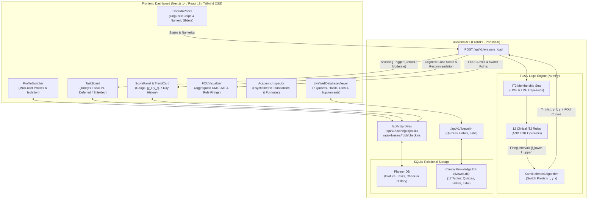

# Computing with Words (CWW) Behavioral Load Manager
### Fuzzy Sprint Shield

> **An Interval Type-2 (IT2) Fuzzy Inference & Clinical Decision Support System for Dynamic Cognitive Workload Management, Task Reprioritization, and Longitudinal Burnout Prevention.**

[](https://www.python.org/)
[](https://fastapi.tiangolo.com/)
[](https://nextjs.org/)
[](https://www.typescriptlang.org/)
[](https://tailwindcss.com/)
[](https://pytest.org/)
[](https://vitest.dev/)
[](LICENSE)

---

## 1. Executive Summary

Traditional task scheduling systems treat human cognitive and physical capacity as a rigid numerical variable (e.g., *"Rate your stress from 1 to 10"*). In reality, human psychological and physiological states are inherently subjective and linguistic (e.g., *"I feel drained"* or *"I am under intense pressure"*). Furthermore, the exact operational meaning of these linguistic terms carries individual and contextual uncertainty.

The **Computing with Words (CWW) Behavioral Load Manager** (also known as **Fuzzy Sprint Shield**) bridges computational intelligence and clinical lifestyle medicine using **Interval Type-2 (IT2) Fuzzy Logic**. By capturing word uncertainty within a **Footprint of Uncertainty (FOU)** bounded by Upper and Lower Membership Functions (UMF & LMF), the engine uses an iterative **Karnik-Mendel (KM)** type-reduction algorithm to defuzzify multi-driver linguistic states into a crisp **Cognitive Load Score (0–100)** and centroid interval $[y_l, y_r]$.

This score dynamically reprioritizes tasks on an adaptive Kanban board—automatically shielding users from cognitive exhaustion by deferring high-demand tasks when critical load thresholds are reached.

---

## 2. Key Capabilities & Features

* **Natural Linguistic Inputs:** Capture behavioral states across 4 clinical drivers (**Fatigue**, **Stress**, **Sleep Quality**, and **Task Demand**) using intuitive linguistic word chips or continuous fine-tuning sliders.
* **Interval Type-2 Fuzzy Engine:** Evaluates multi-rule antecedents using minimum (AND) and maximum (OR) t-norms and s-norms across trapezoidal UMF and LMF bounds without reliance on external fuzzy black-box libraries.
* **Pure NumPy Karnik-Mendel Type-Reduction:** Iterative KM algorithm calculating left and right switch points ($y_l, y_r$) and centroid interval $[y_l, y_r]$, defuzzifying to a crisp score:
  $$Y_{\text{crisp}} = \frac{y_l + y_r}{2}$$
* **Graded Task Reprioritization & Shielding:**
  * **Critical Load ($> 65$):** Deep-work shielding activates (`defer_deep_work`); high-demand tasks are moved to *"Tomorrow / Shielded"*, protecting focus.
  * **Moderate Load ($35 - 65$):** Load-capped schedule (`limit_deep_work`); permits at most one deep-work session today, deferring remainder.
  * **Low Load ($< 35$):** Full capacity (`normal_schedule`); all scheduled tasks remain in today's active sprint.
* **Full Task Management (CRUD):** Add, inline-edit (title, category, load type, duration), toggle completion, and delete tasks directly within the adaptive Kanban interface.
* **Multi-Profile Management:** Create, switch, rename, and delete distinct user profiles with automated starter task seeding and cascade isolation.
* **7-Day Longitudinal History & Trend Analytics:** Historical check-in tracking with a 10-minute debouncing window, visualizing cognitive load evolution and centroid intervals over time.
* **Interactive FOU & Switch Point Inspector:** Real-time Recharts visualization displaying aggregated UMF/LMF curves, shaded FOU area, switch points $y_l$ and $y_r$, and active rule firing strengths.
* **Clinical Knowledge Engine & Screening Quizzes:** Relational database (`livewell.db`, 17 tables) with 7 evidence-based clinical screening instruments (metabolic, endocrine, toxic, gut, mitochondrial, and cellular health) and an actionable microhabits catalog.

---

## 3. Architecture & System Flow



---

## 4. Psychometric & Clinical Foundations

The 4 behavioral drivers and 12 inference rules are grounded in peer-reviewed clinical diagnostic scales and occupational health frameworks:

| Behavioral Driver | Clinical Scale & Reference | Physiological Rationale |
| :--- | :--- | :--- |
| **Fatigue** | **Samn-Perelli Fatigue Scale (SPS)** & **Stanford Sleepiness Scale** | Flight surgeon aviation medicine standard. Levels 1–2 represent homeostatic vigor; levels 3–4 represent 15–25% cognitive deceleration; levels 5–7 reflect severe working memory impairment. |
| **Stress** | **Cohen's Perceived Stress Scale (PSS-10)** & **Yerkes-Dodson Law** | Measures perceived environmental demand exceeding coping capacity. Moderate eustress promotes focus; distress triggers cortisol-driven prefrontal cortex hypofunction. |
| **Sleep Quality** | **Pittsburgh Sleep Quality Index (PSQI)** & **Dawson-Reid Model** | Somnology standard. Extended wakefulness and fragmented sleep induce neurocognitive psychomotor lapses equivalent to blood alcohol concentrations $> 0.05\%$. |
| **Task Demand** | **NASA Task Load Index (NASA-TLX)** & **Cowan 4-Chunk Model** | Ergonomics workload standard. Working memory is strictly limited ($4 \pm 1$ items); complex multi-stage tasks require substantial executive buffer capacity. |

### The 12 IT2 Clinical Interaction Rules

1. **R1 (Optimal Baseline):** `IF Fatigue is Energized AND Stress is Relaxed AND Sleep is Restful THEN Load is Low`
2. **R2 (Calm Reserve):** `IF Fatigue is Energized AND Stress is Relaxed THEN Load is Low`
3. **R3 (Eustress Efficiency):** `IF Fatigue is Energized AND Stress is Pressured AND Task is Routine THEN Load is Moderate`
4. **R4 (Buffered Capacity):** `IF Fatigue is Energized AND Sleep is Restful AND Task is Intense THEN Load is Moderate`
5. **R5 (Somatic Deceleration):** `IF Fatigue is Drained AND Stress is Relaxed THEN Load is Moderate`
6. **R6 (Compensated Fragmentation):** `IF Sleep is Restless AND Task is Routine THEN Load is Moderate`
7. **R7 (Dual Strain):** `IF Fatigue is Drained AND Stress is Pressured THEN Load is Critical`
8. **R8 (Single-Point Failure):** `IF Fatigue is Exhausted OR Stress is Overwhelmed THEN Load is Critical`
9. **R9 (Acute Deprivation / Demand):** `IF Sleep is Deprived OR (Task is Intense AND Fatigue is Drained) THEN Load is Critical`
10. **R10 (Triple Cumulative Strain):** `IF Fatigue is Drained AND Sleep is Restless AND Task is Challenging THEN Load is Critical`
11. **R11 (Working Memory Saturation):** `IF Stress is Pressured AND Task is Intense THEN Load is Critical`
12. **R12 (Mandatory Safety Stop):** `IF Sleep is Deprived THEN Load is Critical`

---

## 5. Clinical Knowledge Base & Screening Quizzes

The repository includes a seeded clinical knowledge base (`livewell.db`) containing **220+ clinical records** across 17 relational tables:

* **8 Habits of Vitality:** Daily morning routines, meal guidance, evening wind-downs, and superpower checks for Physical Activity, Nutrition, Digestive Health, Cellular Mitochondria, Sleep, Mental Wellness, Social Connection, and Detoxification.
* **7 Validated Clinical Screening Instruments:**
  1. *Insulin Resistance Risk Quiz (10 items)* $\rightarrow$ Low (0–2), Moderate (3–5), High (6–10)
  2. *Hormone Health Questionnaire (10 items)* $\rightarrow$ Mild (0–3), Moderate (4–6), Severe (7–10)
  3. *Environmental Toxins Risk Quiz (10 items)* $\rightarrow$ Mild (0–3), Moderate (4–6), Severe (7+)
  4. *Gut Health Assessment (10 items, 0–3 scale)* $\rightarrow$ Awesome (0–7), TLC (8–15), Moderate (16–23), High (24–30)
  5. *Epigenetic Health Self-Assessment (10 items)* $\rightarrow$ Mild (0–3), Moderate (4–6), Severe (7–10)
  6. *Mitochondrial Health Risk Score (10 items)* $\rightarrow$ Low (0–10), Moderate (11–20), High (21–30)
  7. *Stem Cell Vitality Score (11 items)* $\rightarrow$ Low (0–10), Moderate (11–20), High (21–30)
* **MY GOAL DO IT Microhabits:** 40 categorized behavioral interventions for chronic disease prevention and cognitive restoration.
* **Therapeutic Supplements & Labs:** Evidence-based botanicals (Curcumin, Omega-3, Boswellia, CoQ10, Berberine) and biomarker directories (insurance-covered vs. functional longevity testing).

---

## 6. Directory Structure

```text
/repo_root
├── README.md                           # Master Project Documentation
├── PRD.md                              # Product Requirements Document
├── Architecture.md                     # Technical Architecture & Algorithmic Specs
├── CLINICAL_EVIDENCE_RULEBASE.md       # Clinical Literature & Psychometric Citations
├── LIVEWELL_DATABASE_DOCUMENTATION.md  # Relational Database Schema & Quiz Specifications
├── backend/
│   ├── main.py                         # FastAPI App & Endpoint Registration
│   ├── requirements.txt                # Python Dependencies
│   ├── database/
│   │   ├── schema.sql                  # Complete SQL DDL Schema (17 Tables)
│   │   ├── livewell.db                 # Seeded SQLite Database (Clinical Knowledge Base)
│   │   ├── planner.db                  # User Profiles, Tasks, and Check-in History
│   │   ├── db_service.py               # LiveWell Query & Assessment Service Layer
│   │   ├── planner_service.py          # Profile, Task CRUD & Check-in Persistence
│   │   ├── livewell_data.json          # Exported JSON Knowledge Base
│   │   └── seed_from_docx.py           # Automated Ingestion & Seeding Script
│   ├── fuzzy_engine/
│   │   ├── __init__.py
│   │   ├── it2_sets.py                 # IT2 Trapezoidal UMF & LMF Membership Functions
│   │   ├── rules.py                    # 12-Rule IT2 Fuzzy Inference Engine
│   │   └── karnik_mendel.py            # Pure NumPy Karnik-Mendel Type-Reduction
│   ├── routers/
│   │   ├── __init__.py
│   │   ├── livewell.py                 # REST API Router for Quizzes & Habits
│   │   └── planner.py                  # REST API Router for Profiles, Tasks, Check-ins
│   └── tests/
│       ├── test_api.py                 # API Contract & Triage Tests
│       ├── test_it2_sets.py            # Membership Function Math & FOU Tests
│       ├── test_karnik_mendel.py       # KM Iteration & Switch Point Tests
│       ├── test_livewell_db.py         # Database Query & Scoring Rule Tests
│       └── test_planner.py             # Profile, Task CRUD, Check-in & Isolation Tests
└── frontend/
    ├── package.json
    ├── tailwind.config.js
    ├── tsconfig.json
    ├── vitest.config.mts               # Vitest Unit & Component Test Configuration
    └── src/
        ├── app/
        │   ├── layout.tsx
        │   ├── page.tsx                # Main Next.js Dashboard & Tab Orchestration
        │   └── globals.css             # Watermelon Theme & Glassmorphism Design System
        ├── components/
        │   ├── SidebarNav.tsx          # Brand Sidebar, Tab Switching & Status Pill
        │   ├── ProfileSwitcher.tsx     # Profile Selector, Creator, Renamer
        │   ├── CheckInPanel.tsx        # 4-Driver Linguistic Chips & Fine Sliders
        │   ├── ScorePanel.tsx          # Real-Time Score Gauge, [y_l, y_r] & Active Rules
        │   ├── TrendCard.tsx           # 7-Day Longitudinal History Sparkline
        │   ├── TaskBoard.tsx           # Adaptive Kanban Board with Deep-Work Shielding
        │   ├── FOUVisualizer.tsx       # Recharts IT2 FOU Curve & Rule Matrix Viewer
        │   ├── AcademicInspector.tsx   # Formal Psychometric Rationale Inspector
        │   ├── LiveWellDatabaseViewer.tsx # Clinical Quizzes, Habits & Labs Explorer
        │   └── ui/                     # Accessible UI Primitives (Button, Modal, etc.)
        ├── utils/
        │   ├── api.ts                  # Typed Client SDK for Backend Endpoints
        │   ├── plan.ts                 # Graded Reprioritization & Task Splitting Logic
        │   └── usePlanner.ts           # React Hook for Profiles, Tasks & Debounced Check-ins
        └── __tests__/
            ├── fixtures.ts             # Test Mock Data & API Responses
            ├── plan.test.ts            # Graded Plan Splitting Unit Tests
            ├── ScorePanel.test.tsx     # Score Gauge & Centroid Interval Tests
            └── TaskBoard.test.tsx      # Kanban Task Board & Shielding Tests
```

---

## 7. Installation & Quickstart

### Prerequisites
* **Python:** 3.10 or higher
* **Node.js:** 18.0 or higher
* **npm:** 9.0 or higher

### Step 1: Set Up Backend

```bash
# Navigate to the backend directory
cd backend

# Create and activate a Python virtual environment
python3 -m venv venv
source venv/bin/activate   # On Windows: venv\Scripts\activate

# Install dependencies
pip install -r requirements.txt

# Launch the FastAPI backend server
python3 main.py
```

The API will be live at `http://localhost:8000`. You can inspect the interactive Swagger API documentation at `http://localhost:8000/docs`.

### Step 2: Set Up Frontend

In a separate terminal window:

```bash
# Navigate to the frontend directory
cd frontend

# Install Node dependencies
npm install

# Start the Next.js development server
npm run dev
```

Open your browser and navigate to `http://localhost:3000`.

---

## 8. Running the Test Suites

Both backend and frontend are protected by comprehensive test suites verifying mathematical correctness, API contracts, task scheduling, and UI components.

### Backend Tests (Pytest — 31 Tests)

```bash
# Run pytest from repo root with backend in PYTHONPATH
PYTHONPATH=backend pytest backend/tests -v
```

**Coverage highlights:**
* IT2 membership function bounds, monotonicity, and FOU integrity.
* Karnik-Mendel algorithm convergence, symmetry, and switch-point accuracy.
* Evaluation endpoint contracts and graded action recommendations.
* Multi-profile isolation, task CRUD, and check-in debouncing logic.
* Clinical knowledge base scoring algorithms across all 7 diagnostic quizzes.

### Frontend Tests (Vitest — 15 Tests)

```bash
# Run vitest from frontend directory
cd frontend
npm test
```

**Coverage highlights:**
* TaskBoard deep-work shielding when load is critical ($>65$).
* Graded task allocation when load is moderate ($35-65$) or low ($<35$).
* Task form validation (rejection of empty titles, default load types).
* Task completion toggling and deletion.
* ScorePanel score rendering, centroid interval display, and loading states.

---

## 9. API Reference

### 1. Evaluate Cognitive Load
* **Route:** `POST /api/v1/evaluate_load`
* **Request Body:**
  ```json
  {
    "user_id": "u_12345",
    "fatigue_state": "Drained",
    "stress_state": "Pressured",
    "sleep_state": "Restless",
    "task_complexity_state": "Challenging",
    "fatigue_numeric": 50.0,
    "stress_numeric": 55.0
  }
  ```
* **Response Body:**
  ```json
  {
    "user_id": "u_12345",
    "cognitive_load_score": 82.4,
    "recommended_action": "defer_deep_work",
    "km_iterations": 2,
    "km_iterations_left": 2,
    "km_iterations_right": 2,
    "y_left": 78.2,
    "y_right": 86.6,
    "top_rule_ids": [7],
    "triggered_rules_count": 5,
    "rule_firings": [
      {
        "rule_id": 7,
        "rule_text": "IF Fatigue is Drained AND Stress is Pressured THEN Load is Critical",
        "justification": "Dual strain: physical exhaustion compounded by psychological pressure.",
        "consequent": "Critical",
        "operator": "AND",
        "f_lower": 0.8,
        "f_upper": 1.0,
        "is_triggered": true,
        "is_top_rule": true
      }
    ],
    "fou_curves": {
      "domain": [0.0, 1.0, 2.0, "...", 100.0],
      "aggregated_umf": [0.0, "...", 1.0],
      "aggregated_lmf": [0.0, "...", 1.0]
    }
  }
  ```

### 2. Planner & Task Management Endpoints
* `GET /api/v1/profiles` — List all user profiles
* `POST /api/v1/profiles` — Create a new profile with starter tasks
* `PATCH /api/v1/profiles/{pid}` — Rename a profile
* `DELETE /api/v1/profiles/{pid}` — Delete a profile and all associated data
* `GET /api/v1/users/{pid}/tasks` — List tasks for a given profile
* `POST /api/v1/users/{pid}/tasks` — Add a new task (title, category, load type, minutes)
* `PATCH /api/v1/users/{pid}/tasks/{task_id}` — Edit task properties or toggle done status
* `DELETE /api/v1/users/{pid}/tasks/{task_id}` — Remove a task
* `GET /api/v1/users/{pid}/checkins?days=7` — Retrieve longitudinal check-in history
* `POST /api/v1/users/{pid}/checkins` — Record a check-in (auto-merges if within 10 minutes)

### 3. Clinical Knowledge Base Endpoints
* `GET /api/v1/livewell/overview` — High-level metadata and record counts
* `GET /api/v1/livewell/habits` — 8 Superheroes with daily routines and superpower checks
* `GET /api/v1/livewell/quizzes` — Catalog of all 7 clinical screening quizzes
* `GET /api/v1/livewell/quizzes/{quiz_code}` — Questions and scoring rules for a specific quiz
* `POST /api/v1/livewell/quizzes/{quiz_code}/evaluate` — Evaluates quiz answers and returns clinical triage advice
* `GET /api/v1/livewell/microhabits?driver_name=Gut+Health` — MY GOAL DO IT microhabits catalog
* `GET /api/v1/livewell/supplements` — Evidence-based botanicals, indications, and dosages
* `GET /api/v1/livewell/labs?category=Insurance+Covered` — Laboratory biomarker directory

---

## 10. Research & Academic Context

This project represents an applied implementation of **Computing with Words (CWW)** and **Interval Type-2 Fuzzy Logic Systems (IT2 FLS)**. It demonstrates how subjective human expressions can be modeled rigorously without loss of uncertainty, providing intelligent, non-intrusive decision support to mitigate cognitive overload and prevent occupational burnout.

---

## 11. License

This project is licensed under the MIT License — see the [LICENSE](LICENSE) file for details.
