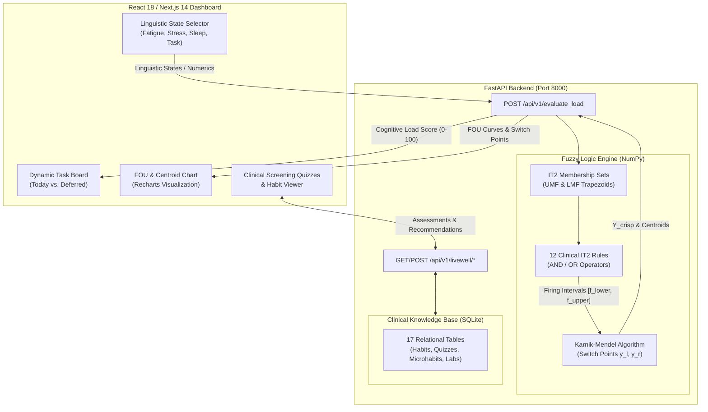

# Computing with Words (CWW) Behavioral Load Manager

> **An Interval Type-2 (IT2) Fuzzy Inference & Clinical Decision Support System for Dynamic Cognitive Workload Management and Task Reprioritization.**

[](https://www.python.org/)
[](https://fastapi.tiangolo.com/)
[](https://nextjs.org/)
[](https://www.typescriptlang.org/)
[](https://tailwindcss.com/)
[](https://pytest.org/)
[](LICENSE)

---

## 1. Executive Summary

Traditional task scheduling systems treat human capacity as a static, rigid number (e.g., *"Rate your stress from 1 to 10"*). In reality, human psychological and physiological states are inherently subjective and linguistic (e.g., *"I feel drained"* or *"I am overwhelmed"*). The meaning of these words varies significantly across individuals and contexts.

The **Computing with Words (CWW) Behavioral Load Manager** solves this fundamental limitation using **Interval Type-2 (IT2) Fuzzy Logic**. By capturing word uncertainty within a **Footprint of Uncertainty (FOU)** bounded by Upper and Lower Membership Functions (UMF & LMF), the engine uses the iterative **Karnik-Mendel (KM)** type-reduction algorithm to defuzzify multi-driver linguistic states into a crisp **Cognitive Load Score (0–100)**. This score dynamically reprioritizes tasks on a real-time Kanban board—automatically shielding users from cognitive exhaustion by deferring complex tasks when critical load thresholds are reached.

---

## 2. Key Capabilities & Features

* **Natural Linguistic Inputs:** Select behavioral states across 4 clinical drivers (**Fatigue**, **Stress**, **Sleep Quality**, and **Task Complexity**) using linguistic chips or continuous sliders.
* **Interval Type-2 Fuzzy Engine:** Evaluates multi-rule antecedents using minimum (AND) and maximum (OR) operators across trapezoidal UMF and LMF bounds without third-party fuzzy libraries.
* **Pure NumPy Karnik-Mendel Type-Reduction:** Iterative algorithm calculating switch points ($y_l, y_r$) and centroid interval $[y_l, y_r]$, defuzzifying to a crisp score:
  $$Y_{\text{crisp}} = \frac{y_l + y_r}{2}$$
* **Dynamic Kanban Reprioritization:** Real-time task dashboard that automatically classifies work into *"Today's Focus"* vs. *"Deferred to Tomorrow"* when the cognitive load score exceeds the critical threshold ($> 65$).
* **Interactive FOU & Switch Point Inspector:** Real-time Recharts visualization displaying aggregated UMF/LMF curves, FOU area, switch points $y_l$ and $y_r$, and active rule firing strengths.
* **Clinical Knowledge Engine & Screening Quizzes:** Relational database with 7 evidence-based clinical screening instruments (metabolic, endocrine, toxic, gut, mitochondrial, and cellular health) and an actionable microhabits catalog.

---

## 3. Architecture & System Flow



---

## 4. Psychometric & Clinical Foundations

The 4 input drivers and 12 inference rules are grounded in peer-reviewed clinical diagnostic scales and occupational health frameworks:

| Behavioral Driver | Clinical Scale & Reference | Physiological Rationale |
| :--- | :--- | :--- |
| **Fatigue** | **Samn-Perelli Fatigue Scale (SPS)** & **Stanford Sleepiness Scale** | Flight surgeon aviation medicine standard. Levels 1–2 represent homeostatic vigor; levels 3–4 represent 15–25% cognitive deceleration; levels 5–7 reflect severe working memory impairment. |
| **Stress** | **Cohen's Perceived Stress Scale (PSS-10)** & **Yerkes-Dodson Law** | Measures perceived environmental demand exceeding coping capacity. Eustress promotes focus, while acute distress triggers cortisol-driven prefrontal cortex hypofunction. |
| **Sleep Quality** | **Pittsburgh Sleep Quality Index (PSQI)** & **Dawson-Reid Model** | Somnology standard. Research in *Nature* demonstrated wakefulness > 24 hours induces neurocognitive psychomotor lapses equivalent to a 0.10% blood alcohol concentration. |
| **Task Complexity** | **NASA Task Load Index (NASA-TLX)** & **Cowan 4-Chunk Model** | Surgical and ergonomics workload standard. Central working memory is capped at $4 \pm 1$ items; complex tasks (> 5 chunks) require dedicated cognitive buffering. |

### The 12 IT2 Clinical Interaction Rules

1. **R1 (Optimal Baseline):** `IF Fatigue is Energized AND Stress is Relaxed AND Sleep is Restful THEN Load is Low`
2. **R2 (Calm Reserve):** `IF Fatigue is Energized AND Stress is Relaxed THEN Load is Low`
3. **R3 (Eustress Efficiency):** `IF Fatigue is Energized AND Stress is Pressured AND Task is Routine THEN Load is Moderate`
4. **R4 (Buffered Capacity):** `IF Fatigue is Energized AND Sleep is Restful AND Task is Intense THEN Load is Moderate`
5. **R5 (Somatic Deceleration):** `IF Fatigue is Drained AND Stress is Relaxed THEN Load is Moderate`
6. **R6 (Compensated Fragmentation):** `IF Sleep is Restless AND Task is Routine THEN Load is Moderate`
7. **R7 (Dual Strain):** `IF Fatigue is Drained AND Stress is Pressured THEN Load is Critical`
8. **R8 (Single-Point Failure):** `IF Fatigue is Exhausted OR Stress is Overwhelmed THEN Load is Critical`
9. **R9 (Acute Deprivation / Demand):** `IF Sleep is Deprived OR (Task is Intense AND Fatigue is Drained) THEN Load is Critical`
10. **R10 (Triple Cumulative Strain):** `IF Fatigue is Drained AND Sleep is Restless AND Task is Challenging THEN Load is Critical`
11. **R11 (Working Memory Saturation):** `IF Stress is Pressured AND Task is Intense THEN Load is Critical`
12. **R12 (Mandatory Safety Stop):** `IF Sleep is Deprived THEN Load is Critical`

---

## 5. Clinical Knowledge Base & Screening Quizzes

The repository includes a standalone relational database engine (`livewell.db`) containing **220+ clinical records** across 17 tables:

* **8 Habits of Vitality:** Daily morning routines, meal guidance, evening wind-downs, and superpower checks for Physical Activity, Nutrition, Digestive Health, Cellular Mitochondria, Sleep, Mental Wellness, Social Connection, and Detoxification.
* **7 Validated Clinical Screening Instruments:**
  1. *Insulin Resistance Risk Quiz (10 items)* $\rightarrow$ Low (0–2), Moderate (3–5), High (6–10)
  2. *Hormone Health Questionnaire (10 items)* $\rightarrow$ Mild (0–3), Moderate (4–6), Severe (7–10)
  3. *Environmental Toxins Risk Quiz (10 items)* $\rightarrow$ Mild (0–3), Moderate (4–6), Severe (7+)
  4. *Gut Health Assessment (10 items, 0–3 scale)* $\rightarrow$ Awesome (0–7), TLC (8–15), Moderate (16–23), High (24–30)
  5. *Epigenetic Health Self-Assessment (10 items)* $\rightarrow$ Mild (0–3), Moderate (4–6), Severe (7–10)
  6. *Mitochondrial Health Risk Score (10 items)* $\rightarrow$ Low (0–10), Moderate (11–20), High (21–30)
  7. *Stem Cell Vitality Score (11 items)* $\rightarrow$ Low (0–10), Moderate (11–20), High (21–30)
* **MY GOAL DO IT Microhabits:** 40 categorized behavioral interventions for chronic disease prevention.
* **Therapeutic Supplements & Labs:** Evidence-based botanicals (Curcumin, Omega-3, Boswellia, CoQ10, Berberine) and biomarker directories (insurance-covered vs. functional longevity testing).

---

## 6. Directory Structure

```text
/repo_root
├── README.md                           # Master Project Documentation
├── PRD.md                              # Product Requirements Document
├── Architecture.md                     # Technical Architecture & Algorithmic Specs
├── CLINICAL_EVIDENCE_RULEBASE.md       # Clinical Literature & Psychometric Citations
├── LIVEWELL_DATABASE_DOCUMENTATION.md  # Relational Database Schema & Quiz Specifications
├── backend/
│   ├── main.py                         # FastAPI App & Endpoint Registration
│   ├── requirements.txt                # Python Dependencies
│   ├── database/
│   │   ├── schema.sql                  # Complete SQL DDL Schema (17 Tables)
│   │   ├── livewell.db                 # Seeded SQLite Database
│   │   ├── db_service.py               # Database Query & Assessment Service Layer
│   │   ├── livewell_data.json          # Exported JSON Knowledge Base
│   │   └── seed_from_docx.py           # Automated Ingestion & Seeding Script
│   ├── fuzzy_engine/
│   │   ├── __init__.py
│   │   ├── it2_sets.py                 # IT2 Trapezoidal UMF & LMF Membership Functions
│   │   ├── rules.py                    # 12-Rule IT2 Fuzzy Inference Engine
│   │   └── karnik_mendel.py            # Pure NumPy Karnik-Mendel Type-Reduction
│   ├── routers/
│   │   ├── __init__.py
│   │   └── livewell.py                 # REST API Router for Quizzes & Habits
│   └── tests/
│       ├── test_api.py                 # API Contract & Triage Tests
│       ├── test_it2_sets.py            # Membership Function Math Tests
│       ├── test_karnik_mendel.py       # KM Iteration & Switch Point Tests
│       └── test_livewell_db.py         # Database Query & Scoring Rule Tests
└── frontend/
    ├── package.json
    ├── tailwind.config.js
    ├── tsconfig.json
    └── src/
        ├── app/
        │   ├── layout.tsx
        │   ├── page.tsx                # Main Next.js Dashboard
        │   └── globals.css             # Glassmorphism & Modern Theme Styling
        ├── components/
        │   ├── Header.tsx              # Brand Header & Centroid Badge
        │   ├── StateSelectorModal.tsx  # 4-Driver Linguistic & Continuous Sliders
        │   ├── TaskBoard.tsx           # Dynamic Kanban Task Reprioritization
        │   ├── FOUVisualizer.tsx       # Recharts IT2 FOU Curve & Rule Matrix Viewer
        │   ├── AcademicInspector.tsx   # Formal Psychometric Rationale Inspector
        │   └── LiveWellDatabaseViewer.tsx # Interactive Clinical Quizzes & Habits Viewer
        └── utils/
            └── api.ts                  # Typed Client SDK for Backend Endpoints
```

---

## 7. Installation & Quickstart

### Prerequisites
* **Python:** 3.10 or higher
* **Node.js:** 18.0 or higher
* **npm:** 9.0 or higher

### Step 1: Set Up Backend

```bash
# Navigate to the backend directory
cd backend

# Create and activate a Python virtual environment
python3 -m venv venv
source venv/bin/activate   # On Windows: venv\Scripts\activate

# Install dependencies
pip install -r requirements.txt

# (Optional) Re-seed the clinical database from schema
python3 database/seed_from_docx.py

# Launch the FastAPI backend server
python3 main.py
```

The API will be live at `http://localhost:8000`. You can inspect the interactive Swagger API documentation at `http://localhost:8000/docs`.

### Step 2: Set Up Frontend

In a new terminal window:

```bash
# Navigate to the frontend directory
cd frontend

# Install Node dependencies
npm install

# Start the Next.js development server
npm run dev
```

Open your browser and navigate to `http://localhost:3000`.

---

## 8. Running the Test Suite

The backend contains a unit test suite validating the Karnik-Mendel algorithm, fuzzy membership sets, API contracts, and database scoring rules:

```bash
# Run pytest with the backend directory in your python path
PYTHONPATH=backend pytest backend/tests -v
```

**Expected output:**
```text
backend/tests/test_api.py::test_root PASSED
backend/tests/test_api.py::test_health PASSED
backend/tests/test_api.py::test_evaluate_load_critical PASSED
backend/tests/test_api.py::test_evaluate_load_low PASSED
backend/tests/test_api.py::test_evaluate_load_invalid_state PASSED
backend/tests/test_it2_sets.py::test_trapmf_bounds PASSED
backend/tests/test_it2_sets.py::test_it2_fuzzy_set_evaluation PASSED
backend/tests/test_it2_sets.py::test_all_drivers_defined PASSED
backend/tests/test_karnik_mendel.py::test_km_monotonicity PASSED
backend/tests/test_karnik_mendel.py::test_km_symmetric_centroid PASSED
backend/tests/test_karnik_mendel.py::test_km_convergence PASSED
backend/tests/test_livewell_db.py::test_db_service_overview PASSED
backend/tests/test_livewell_db.py::test_api_livewell_overview PASSED
backend/tests/test_livewell_db.py::test_api_livewell_habits PASSED
backend/tests/test_livewell_db.py::test_api_livewell_quizzes PASSED
backend/tests/test_livewell_db.py::test_api_livewell_single_quiz PASSED
backend/tests/test_livewell_db.py::test_api_livewell_evaluate_quiz_high_risk PASSED
backend/tests/test_livewell_db.py::test_api_livewell_evaluate_quiz_low_risk PASSED
backend/tests/test_livewell_db.py::test_api_livewell_evaluate_gut_health PASSED
backend/tests/test_livewell_db.py::test_api_livewell_supplements PASSED
backend/tests/test_livewell_db.py::test_api_livewell_labs PASSED
backend/tests/test_livewell_db.py::test_api_livewell_microhabits PASSED
============================== 22 passed in 0.28s ==============================
```

---

## 9. API Reference

### 1. Evaluate Cognitive Load
* **Route:** `POST /api/v1/evaluate_load`
* **Request Body:**
  ```json
  {
    "user_id": "u_12345",
    "fatigue_state": "Drained",
    "stress_state": "Pressured",
    "sleep_state": "Restless",
    "task_complexity_state": "Challenging",
    "fatigue_numeric": 50.0,
    "stress_numeric": 55.0
  }
  ```
* **Response Body:**
  ```json
  {
    "cognitive_load_score": 82.4,
    "recommended_action": "defer_deep_work",
    "km_iterations": 2,
    "km_iterations_left": 2,
    "km_iterations_right": 2,
    "y_left": 78.2,
    "y_right": 86.6,
    "top_rule_ids": [7],
    "triggered_rules_count": 5,
    "rule_firings": [...],
    "fou_curves": {
      "domain": [0, 1, ..., 100],
      "aggregated_umf": [0.0, ..., 1.0],
      "aggregated_lmf": [0.0, ..., 1.0]
    }
  }
  ```

### 2. Clinical Knowledge Base Endpoints
* `GET /api/v1/livewell/overview` — High-level metadata and counts
* `GET /api/v1/livewell/habits` — 8 Superheroes with daily routines and superpower checks
* `GET /api/v1/livewell/quizzes` — Catalog of all 7 clinical screening quizzes
* `GET /api/v1/livewell/quizzes/{quiz_code}` — Questions and scoring rules for a specific quiz
* `POST /api/v1/livewell/quizzes/{quiz_code}/evaluate` — Evaluates user answers and returns clinical triage advice
* `GET /api/v1/livewell/microhabits?driver_name=Gut+Health` — MY GOAL DO IT microhabits catalog
* `GET /api/v1/livewell/supplements` — Evidence-based botanicals and dosages
* `GET /api/v1/livewell/labs?category=Insurance+Covered` — Laboratory biomarker directory

---

## 10. Research & Academic Context

This project represents an applied implementation of **Computing with Words (CWW)** and **Interval Type-2 Fuzzy Logic Systems (IT2 FLS)**. It bridges computational mathematics with clinical lifestyle medicine to provide intelligent, human-centered decision support for cognitive health and productivity.

---

## 11. License

This project is licensed under the MIT License — see the [LICENSE](LICENSE) file for details.
